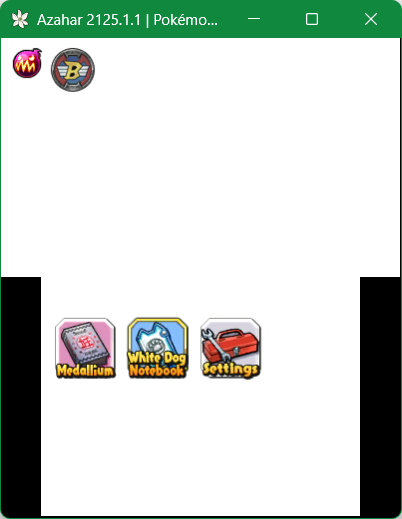

# CTR-Plugin-Toolkit

**A powerful base for building highly customized 3DS plugins with full UI control.**

---

## 🚀 Overview

**CTR-Plugin-Toolkit** is a C++ development framework designed to bypass the default CTRPF interface. It empowers
developers to build entirely custom UIs for the Nintendo 3DS, featuring personalized layouts, buttons, backgrounds, and
custom asset management.

## 🛠️ Prerequisites

To compile and use this plugin, ensure the following are installed and configured:

* **devkitARM**: The essential 3DS homebrew toolchain.
* **libctrpf**: The CTR Plugin Framework library.
* **Python 3.x**: Required to run the asset processing scripts.
* **Pillow (PIL)**: Python library used for image conversion and header generation.

## 📁 Project Structure

* **src/**: Contains the C++ source code for the plugin logic and custom renderer.
* **include/**: Contains header files. The `romfs.h` file is automatically generated here.
* **assets/layout/**: The directory for your UI assets. Organize images into subfolders based on their respective menus.
* **layout_editor.py**: The utility script that processes PNG images into a `romfs.bin` file and updates memory offsets.

## 🎨 UI Customization

### 1. Creating Layouts

Inside the `assets/layout/` folder, create a directory for each menu (e.g., `home`, `status`). Place your `.png` files
within these directories.

### 2. Defining Layouts

Layout definitions are managed within `assets/layout_editor.py` in the `LAYOUTS` dictionary. Each entry defines the
asset name and its $(x, y)$ coordinates on the screen.

### 3. Generating Assets

Running the layout script compiles your images into a single binary file (`romfs.bin`) and generates the necessary C++
defines in `romfs.h` so your code can locate each asset by its memory offset.

## ⚙️ Compilation

The project uses a standard `Makefile`.

* **Build**: Compiles the source code and generates the `.3gx` plugin.
* **Debug**: Generates a debug build linked with `lctrpfd` for use with GDB or error logging.
* **Relink**: A specialized routine for developers using the **Azahar** emulator. It compiles the project, moves the
  plugin and assets to the emulator's SD card directory, and launches the game automatically.

> [!IMPORTANT]
> Before compiling, update the `DEST`, `EMULATOR`, and `GAME_PATH` variables in the `Makefile` to match your local
> environment paths.

## 📜 License

This project is licensed under the **MIT License**. Full details can be found in the header of the source files.

---
*Developed by **David Darras** (a.k.a ZettaD) (2026)*